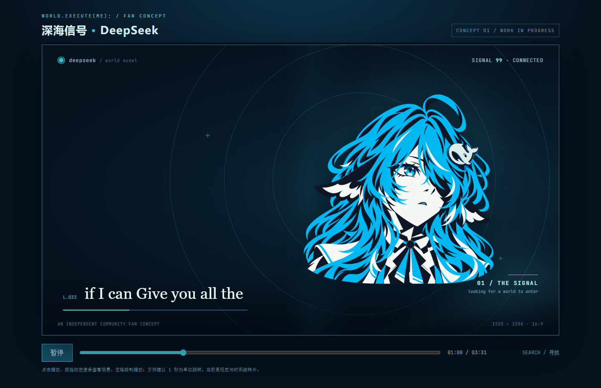

# DeepSeek 主题《world.execute(me);》MV 工作目录

目前是可播放的**全曲动态草片**：全曲56镜覆盖0–211.957596秒，使用v3鲸鱼娘、深海蓝青配色、聊天界面和模型内部图形，支持本机音频、歌词时间线及1080p60离线导出。2026-10-17的[独立验收](docs/dsh-review-2026-10-17.md)已确认工程与视频可运行，仍有镜内事件和片尾连续性需要回修，尚未作为最终成片验收。

## 本机预览

需要 Node.js。先在这个目录运行 `npm run preview`，再打开 `http://localhost:5174/`。URL 可用 `?t=68.8` 跳到首段动态试片的触点镜头。播放器支持空格和方向键。

本机另需放置：

- `audio/song.wav`：与歌曲时间零点对齐的音频。
- `data/lyrics.json`：与歌曲时间对齐的歌词 JSON，格式沿用参考项目的 `data/lyrics.json`。

这两项只在本机使用，已由总目录 `.gitignore` 排除。没有歌词时仍可看画面和时间线。

## 审片台（推荐入口）

`review/index.html` 是专门用来看片的静态页面：**双击即可打开，不需要启动服务**（页面只用 `<video>` 与 ``，没有 fetch 和 ES 模块）。它按镜头列出全部 55 个边界和 12 个镜内候选事件，每行带分镜自己的 `audio_check` 提示；点「审听」会播放该点前后各 2.5 秒后自动停，也可以连续过一遍所有未核点，勾选后可复制结论。

分镜或镜头表变化后，在本目录运行 `npm run review` 重新生成；`npm run check:review` 会用真实 Chrome 以 `file://` 打开它，检查无脚本错误、行数与媒体是否就位。详见 [review/README.md](review/README.md)。

## 角色素材

`assets/character/deepseek_{bust,profile,reach,eye}_v3.png` 是当前使用的透明角色图；`v3_sources/` 保存源图、提示词和质量记录。成品素材的设计讨论与品牌素材说明见 `v3_sources/design_notes_v3.md`。

四张基础图与 Claude 版八张素材的用途对照、拟补素材优先级见 [`docs/character-asset-plan.md`](docs/character-asset-plan.md)。

下一阶段的全曲分镜、试做片段和技术路线见 [`docs/production-plan.md`](docs/production-plan.md)。

全曲 56 镜的设计稿见 [`docs/storyboard-v1.md`](docs/storyboard-v1.md)，对应的程序数据在 `data/storyboard-v1.json`；角色补图条件见 [`docs/character-shot-requests-v1.md`](docs/character-shot-requests-v1.md)。镜头切点仍待人工审听。

首段 S15–S19（59.223–74.045 秒）复用现有角色与掌心素材，包含消息、回路、向掌心推进、一次接触和保存路径。点击“审片 59–74 秒”播放本段；早期精修记录见 [p0-polish-notes.md](docs/p0-polish-notes.md)。用户已确认68.300秒触碰落点，其他切点仍待人工审听。

续段 S20–S27（74.045–95.465 秒）含资源交换、短促尖鳍轮廓后备、外观轮廓预览与两片值班区接力。页面提供“审片74–95秒”和“连续审片59–95秒”。运行 `npm run export:p1` / `npm run export:p0-p1` 输出独立与连续的1080p60带声音MP4；`npm run check:p1`检查关键帧、字幕和反向跳转。早期制作与验证见 [p1-production-notes.md](docs/p1-production-notes.md)，两项素材缺口仍见 [p1-asset-request.md](docs/p1-asset-request.md)。旧标签页请刷新。

运行 `npm run check:p0` 输出本地关键帧和确定性检查，`npm run export:p0` 离线导出1080p60、H.264/AAC视频。导出优先复用本项目或相邻参考工程已有的Playwright/ffmpeg依赖，独立安装可执行 `npm install`。本地字体与OFL许可在 `assets/fonts/`。音频、歌词、截图和视频继续留在Git之外。

## 渲染引擎 v2

2026-10-16 起，通用绘制逻辑从 `src/p0.js` / `src/p1.js` 抽到 `src/engine/`：**调色后期、运动原语、动态字体、DeepSeek Harness 风格聊天组件、音频采样**。镜头现在只画平面内容，相机与调色由 `src/engine/stage.js` 统一负责，所以任意跳转都得到同一帧。

`tools/build-audio-features.py` 从本机 WAV 生成 `data/audio-features-v1.json`（不入 Git），实测节拍 **129.9954 BPM / 相位 0.31 秒**，与原有记录一致。这套数据现在真正驱动画面：辉光跟随低频呼吸、鼓点让画面轻微上浮。

新增的两个诊断工具把“效果不好”变成了可测量的数字：`tools/filmstrip.mjs`（把一段时间渲成一张胶片）和 `tools/measure-motion.py`（量化到底动了多少）。第一张胶片和第一次实测直接暴露了真问题：**全片约八成帧几乎完全不变**，引擎搭好了但镜头本身没在动。

针对这一点加了 `src/engine/ambient.js`（深海环境运动：漂移光柱、每拍横扫的焦散光带、按拍扩散的声呐环、上浮颗粒）和 `src/engine/transitions.js`（9 种转场）。59.223–95.465 秒实测：

| | 平均帧间差 | 静止帧占比 | 最长静止 |
| --- | --- | --- | --- |
| 上一版 | 0.811 | **80.9%** | 2.267 s |
| 当前 | 2.800 | **23.8%** | 0.233 s |

字幕也一并改成“镜头只规划、舞台在转场合成之后绘制”，否则 dissolve 会把大字歌词切成碎块。详见 [engine-v2.md](docs/engine-v2.md)。

## 目前可看的段落

**全曲 0–211.958 秒（S01–S56）均已绘制**，八段首尾相接，见 [docs/engine-v2.md](docs/engine-v2.md)。概念稿的 DOM 轮播保留作对照，已不参与成片。

各段审片按钮在浏览器控制条上；`npm run export:full` 导出全曲1080p60带声音草片，本机文件为 `out/world-execute-me-deepseek-1080p60.mp4`。闪帧检查目前需显式传视频，例如 `npm run check:flash -- out/world-execute-me-deepseek-1080p60.mp4`；工具的媒体探测及判据局限见验收记录。

## 参考与后续

这个样片从零实现基础播放器和当前画面，没有直接复制 Claude 版的整套场景代码。后续将参考 `world-execute-me-lyric-mv` 的歌词分镜与过渡方法，以及 `world-execute-me-dsh-pv` 的 DeepSeek 界面与视觉元素，逐段设计完整 MV。
