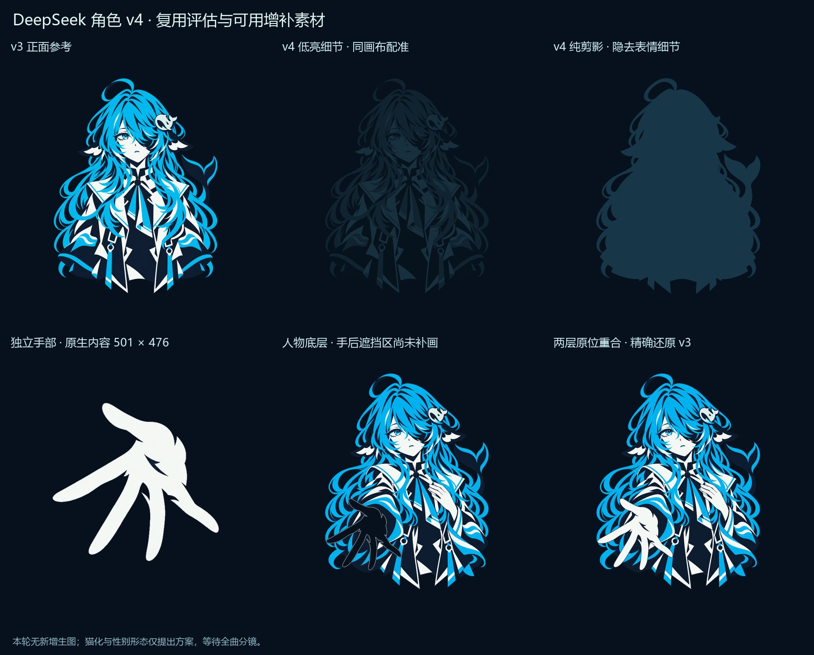
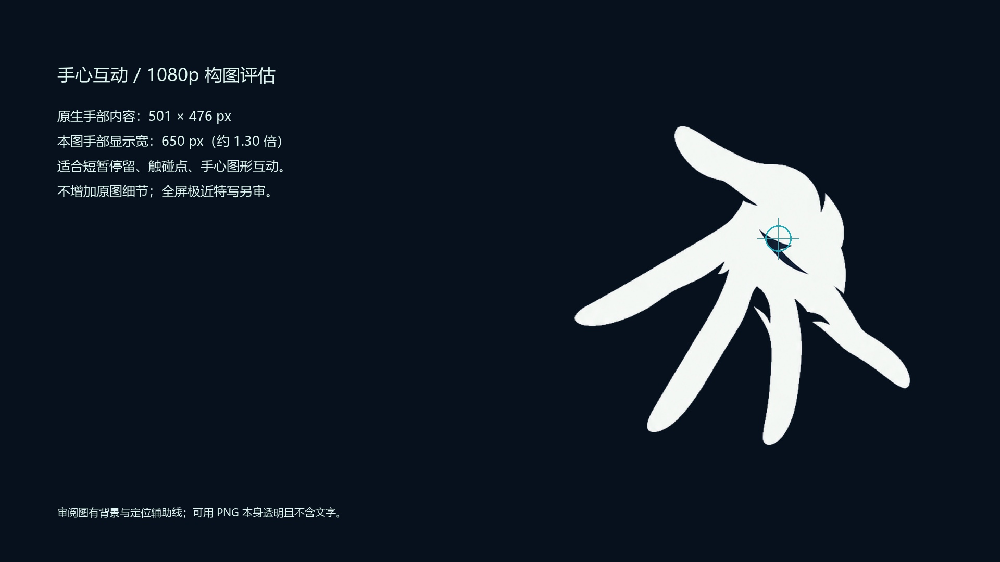

# v4：按镜头复用 v3 的素材增补

完成日期：2026-10-15。已阅读项目 `docs/character-asset-plan.md`、v3 设计说明，并实际查看四张现用 v3 成品及原生手部细节。本轮没有新增生图，所有成品来自现用 v3 的调色、裁切或透明分层；没有修改人物的脸、发型、鲸鳍、鲸尾、鲸鱼发饰和服装结构。v3 原件保持不变，也没有替换当前浏览器样片的素材引用。

## 现在可以用于 MV 的素材

| 文件 | 尺寸 | 用途与可用范围 |
| --- | --- | --- |
| [deepseek_bust_v4_lowlight.png](deepseek_bust_v4_lowlight.png) | 1342×1704 | 保留发型、衣服、发饰的弱细节；用于未上线、离线、低亮出现或情绪退场。与 v3 正面同画布、同位置、同透明轮廓，可以直接交叉淡入。 |
| [deepseek_bust_v4_silhouette.png](deepseek_bust_v4_silhouette.png) | 1342×1704 | 单一深海蓝剪影，五官细节消失，保留呆毛、侧鳍、尾巴和外部发饰轮廓。用于身份揭示前、短暂暗影、形态切换遮罩。它不是一张新画的无表情脸。 |
| [deepseek_palm_v4_closeup_native.png](deepseek_palm_v4_closeup_native.png) | 757×732 | 透明独立手部近景，手的实际像素内容为 501×476，四周各留 128px。保留五指、透视与原掌心阴影，没有补画或高分辨率重绘。 |
| [deepseek_reach_v4_hand_layer.png](deepseek_reach_v4_hand_layer.png) | 1342×1704 | 原伸手图的手层，保持原画布配准；可用于掌心定位、叠加互动元素、局部明暗和小幅运动试验。 |
| [deepseek_reach_v4_body_layer.png](deepseek_reach_v4_body_layer.png) | 1342×1704 | 与手层配对的人物底层。按“人物底层在下，手层在上”原位叠合可精确还原原 v3；手后面留下透明缺口，尚未补画隐藏的袖子、头发或身体。不能单独当作完整人物新姿态。 |

五张 PNG 均保留实际 Alpha，主体到画布边缘至少 128px。预览 JPG 的背景、文字和定位线只用于审阅，不在这些透明素材里。

## 复用评估与需要新绘制的边界

1. 低亮度与纯剪影：现有正面图足够，无需生图。保留同一张图的轮廓比另画一张更利于动画配准，也完全避免脸与服装漂移。
2. 常规伸手：现有 v3 已具备正确镜头用途，直接沿用。独立手部通过原像素分层取得；掌心内部的深蓝阴影也来自原图。
3. 手心近景：已在 1920×1080 的深、浅背景中检查，手部内容显示宽 650px，约为原生的 1.30 倍，可用于短暂停留的互动构图。浅色背景上的轮廓对比更低，采用前需匹配画面底色；不要把 650px 当成严格的质量上限。
4. 全屏手心、长时间停留、极大幅放大、手背/翻掌、屈指、换手势：现有图没有这些真实细节与关节姿态，不能靠裁切或放大得到。若全曲分镜确定使用，才需要以 v3 手、袖口为参考，局部新绘一张所需手势；目前不提前生成。
5. 大幅移动手层会暴露底层缺口。若镜头确需手臂独立旋转或伸缩，再补被遮挡的袖口/身体，并按该镜头拆分前臂。当前分层不等于完成骨骼绑定。
6. 发饰：保留各张 v3 本身已经绘入的形状与透视。关键位置与检查裁切范围已记录；没有把一个正面发饰重新贴到所有姿态上。若未来发饰占据全屏特写，需先锁定一张基准造型，再决定是否补绘局部细节。

## 待全曲分镜决定的三类方案

以下时间来自当前本机 `data/lyrics.json`，只是定位相关歌词的候选窗口，不是已批准或已接入样片的镜头表。

| 类别 | DeepSeek 版视觉方案 | 适用镜头与制作触发条件 |
| --- | --- | --- |
| 性别形态切换，88.587–92.015s | 同一角色的中性/偏男性表达：保留 v3 的眼型、鼻口间距、脸部识别、分缝、长发、呆毛、侧鳍、鲸尾、头饰和水手领。仅轻微收直颈肩线、调整肩宽和领口下方衣片剪裁，不依赖剪短头发或换成另一张脸。 | 若保留该桥段，只补一张与正面同配准的另一形态。切换瞬间先经过现有纯剪影或短促遮罩。所谓成年淡重影可从这张另一形态做 1.02–1.06 倍缩放、轻微错位和约 12%–20% 不透明度，先审镜头，再决定是否需要另一张成年立绘。当前未生成任何性别形态变体。 |
| 猫耳过渡，81.351–82.833s | “鲸鱼娘暂时猫化”，保留原脸、头发、头饰、衣服和鲸尾。将原侧鳍的外轮廓短暂竖起为猫耳般的尖形，保留鳍根与海沫白内侧；避免额外再长一对耳朵。虎斑意象可用两小组低饱和青蓝色块提示，不引入橙毛或新花饰。 | 适合半身或头部近景的短促过渡。若只是几帧剪影，可先试鳍层的遮罩/变形；若需要稳定停留或表情近景，再局部新绘耳/鳍，不重画整个角色。头饰位置应避让尖耳。当前未制作猫耳图。 |
| 猫爪动作，82.833–85.078s | 沿用原宽袖和青色袖口，双手短暂成为蜷握的小爪形：深蓝爪背、海沫白指端、少量青色肉垫。保持鲸尾和发饰，一手抬起、一手稍收，形成呼噜/招呼的节奏。 | 适合胸前双手或手爪近景，与猫耳过渡作为一组使用。现有张开的五指不能直接变成屈指猫爪，若分镜确认使用，需局部新绘一组手/爪动作。无需再生成一名完整猫角色。当前未制作猫爪图。 |

## 来源、提示词与定位

- `sources/deepseek_*_v3.png`：本轮实际使用的四张现用成品的逐字节拷贝，供可复现处理；原始 v3 生图仍保存在上一级 `v3_sources`。
- `sources/v3_imagegen_prompts_reference.json`：此前 v3 的提示词来源记录，不是本轮再次调用生图。
- `sources/build_v4.py`：调色、提手、透明分层与验证流程；`sources/review_v4.py`：生成审阅图和定位文件。
- `sources/reach_hand_mask_v4.png`：原 v3 伸手画布上的手部提取遮罩。
- `metadata/source_provenance.json`：四张 v3 的来源、尺寸与 SHA-256。
- `metadata/operations.json`：具体处理参数、原生裁切范围、原图到手部近景的坐标变换；本轮 `image_generation_used=false`，新生图提示词数组为空。
- `metadata/landmarks_v4.json`：眼睛、发饰、领结、手心、手腕、五指指端的像素与归一化位置。人工镜头配准点为约值，已配图检查；不是精确骨骼关节点。发饰 ROI 是包含邻近头发的检查区域，不是独立发饰遮罩。
- `metadata/storyboard_candidates.json`：上述三种变体的候选窗口和制作条件。
- `metadata/qa_report_v4.json`：透明边距、原件未改变、剪影 Alpha 配准及手/底层重建检查。

角色及鲸鱼头饰仍遵循 v3 的二创设计说明。本包不表示 DeepSeek 官方制作、合作或授权。
