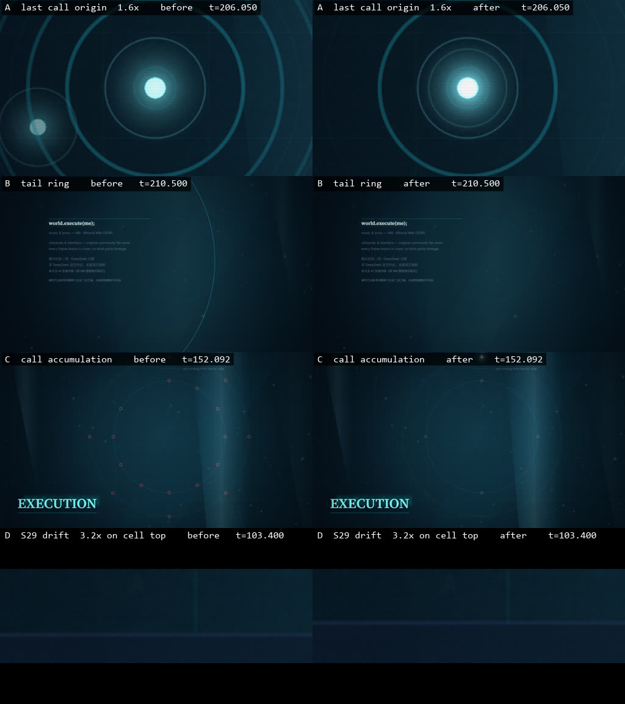

# 全曲回修第一轮 · 记录

2026-10-17。对应 `docs/dsh-fix-round1-prompt.md` 的四条缺陷。本轮只修缺陷、补守卫，未改镜头边界、歌词时间线、`data/storyboard-v1.json`、68.300 触碰落点，未新增素材，未改动其它项目，未提交 Git。

改动文件：`src/p4.js`、`src/p5.js`、`src/p7.js`、`src/mv-draw.js`、`src/engine/motion.js`、`src/p0.js`、`src/main.js`、`tools/export-p0.mjs`、`package.json`；新增 `tools/check-time-windows.mjs`、`tools/probe-times.mjs`、`tools/measure-cell-drift.py`。

---

## 0. 先做的事：把「反向时间窗口」变成可检测的错误

缺陷 B 与 D 是同一个错误：`at(t, a, b)` 传入了 `a > b`。`phase()` 静默 `clamp`，画面看起来有东西在动，语义却是反的——**这种错误在抽帧里看不出来**，只能靠代码位置和数值证明。

### 运行时守卫

`src/engine/motion.js` 新增 `noteReversedWindow(t, a, b, kind)`：当 `b < a` 时记录一次违规（类型、窗口两端、首次出现的 t、命中次数、调用栈前几层），**返回值与原来完全一致**，不抛异常、不打断预览与导出。`b === a` 视为合法退化情形，不报。

两个共享时间助手都接了守卫：`motion.js` 的 `phase`，以及 `mv-draw.js` 自己的 `phase`（分段文件用的其实是后者，`at` 由它派生，所以两条路径都覆盖）。

记录通过 `window.frameDiagnostics.timeWindowViolations` / `timeWindowViolationHits` 暴露。注意 `frameDiagnostics` 每帧重建，所以计数器放在模块内，`main.js` 每帧把快照挂上去——跨帧累积才能一次导出查完，而它不参与任何像素计算。

`tools/export-p0.mjs` 的 stills 模式现在会在结束时读取该报告，**命中数 > 0 即判定失败**。

### 静态扫描

新增 `tools/check-time-windows.mjs`：扫描 `src/` 下所有 `at(` / `phase(` 调用点，对**可静态求值**的窗口（字面量，或同文件内 `P*.cues.*` / `P*.start` / `P*.end` 引用）计算两端，报出 `b < a`。带变量或运行时值的调用计入 `runtime-dependent` 单独统计，不假装覆盖。退出码非 0 表示存在未解释的反向窗口；`INTENTIONAL` 列表可登记刻意为之并附理由。

接入 `npm run check:engine`（先扫描后跑 48 项逻辑检查），另有 `npm run check:windows`。

### 全库扫描结果

修完两条后：

```
time windows: 22 files, 155 statically resolved, 29 runtime-dependent, 0 reversed
```

**除缺陷 B、D 外没有发现其它反向窗口。** 26→29 个 runtime-dependent 的差值来自本轮新增代码里带变量的窗口。

### 守卫本身被验证过

注入一个真正反向的窗口（`P7.cues.pointFadeFrom` 208.85 → 210.0，与 `pointFadeTo` 209.75 构成反向）后：

- 静态扫描：`src/p7.js:49  at(t, 210, 209.75)  width -0.25`，退出码 1 ✓
- 运行时守卫：stills 审计抛出 `Reversed time windows rendered 7 times: mv-draw.phase a=210 b=209.75 hits=7` ✓

恢复后两者均回到 0。**守卫不是「写了但没试过」。**

---

## 1. 缺陷 A：最后一次呼叫没有从旧触点发出

**原因**：`p7.js` 里存在三个互不相同的坐标。保留的旧触点是 `(420,520)`，而自称「最初路径」的 `ORIGIN_PATH` 起点是 `(300,560)`，相距约 126px，206.0 秒载波在触点之外的空白处凭空出现。工程里真正最早的发送路径在 `p0.js`（起点 `(470,570)`），是第三个坐标。

**修改点**：

1. `src/p0.js` 导出 `OUTBOUND_CONTROL`（`[[470,570],[650,200],[1220,120],[1450,410]]`），`outbound` 由它派生，成为唯一事实来源。
2. `src/p7.js` 定义 `TOUCH_POINT = [420,520]` 共享常量。S54 的触点、S55 的环心、载波起点、S56 的环心全部引用它，代码里不再出现第二处 `420` / `520` 字面量对。
3. 原路径的选择：**复用 `p0.js` 的 `outbound`，整体平移并把首控制点锚到老触点**（偏移 `(-50,-50)` → `[[420,520],[600,150],[1170,70],[1400,360]]`）。理由：分镜写的是「沿**最初**路径离开」，而 `p0.js` 的 outbound 才是工程里最早的发送路径；整体平移保留原曲线形状，且不会在教学迁移后留下第二个悬空起点。

**修改前后**：

| 时刻 | before 载波起点 | after 载波起点 | 与触点 (420,520) 距离 |
| --- | --- | --- | --- |
| 205.811（S55 首帧） | 无（`go=0` 时不画） | `[420,520]` | 0.00 px |
| 206.000（`lastCall`） | 无 | `[420,520]` | **0.00 px** |
| 206.050 | 无 | `[420.016,519.967]` | 0.04 px |
| 207.450 | 路径仅推进到 `go=1`，头部在 `(300,560)`→… 的终点 | `[1399.977,359.971]` | 已走完全程 |

`diag.lastCall` 新增字段：`carrierOrigin`、`pathOrigin`、`touchPoint`、`ringRadius`、`ringAlpha`、`pointAlpha`。

**跨 S54→S55 连续**：205.810（S54）`outline.touchPoint = [420,520]`，205.811（S55）`lastCall.touchPoint = [420,520]`，同值。

**206.0–207.45 设计约束保持**：仍是单载波、单方向、不亮在线标记、无回复。头部随 `go→1` 淡出，不做回程。

---

## 2. 缺陷 B：片尾暗环复活（时间窗口写反）

**原因**：`s56` 原为 `const gone = ease(at(t, P7.cues.creditsIn, P7.cues.ringGone));`，即 `at(t, 209.811, 209.4)`，`b-a = -0.411`。S56 区间是 `[209.811, 211.957596)`，`t-a ≥ 0`，除以负数恒为负 → `clamp` 到 0 → `gone ≡ 0` → `gone < 1` 恒真 → **整个 S56 都以 `alpha=0.3`、`radius=mix(900,1100,0)=900` 画一个环**。而 S55 的环在 209.4 已经看不到。结果是「暗环先消失，再在下一镜整段复活」。

**修改点**：建立**一条跨镜连续**的衰减曲线。`S55` 与 `S56` 都调用同一个 `ringAt(t)`：

```js
function ringAt(t) {
  const k = ease(at(t, P7.cues.decay, P7.cues.ringGone));   // 207.45 → 210.9，正向
  return { k, radius: mix(90, 1100, k), alpha: (1 - k) * 0.55 };
}
```

`cues.ringGone` 由 `209.4` 改为 `210.9`（> `decay`，窗口正向）。S56 不再另起一条曲线，也不再引用任何反向窗口。

**实测**（`ringAt` 是 t 的纯函数，几何量在 209.811 处必然连续）：

| 时刻 | 所属镜 | radius | alpha |
| --- | --- | --- | --- |
| 207.450 | S55 | 90.00 | 0.5500 |
| 208.400 | S55 | 181.57 | 0.5001 |
| 209.400 | S55 | 740.51 | 0.1958 |
| 209.794 | S55 | 950.71 | 0.0813 |
| 209.800 | S55 | 953.23 | 0.0799 |
| **209.811** | **S56** | **957.78** | **0.0774** |
| 209.828 | S56 | 964.67 | 0.0737 |
| 209.844 | S56 | 970.97 | 0.0703 |
| 210.500 | S56 | 1095.91 | 0.0022 |
| 211.000 | S56 | 1100.00 | 0.0000 |
| 211.900 | S56 | 1100.00 | 0.0000 |

**radius 单调不减、alpha 单调不增；209.811 前后逐帧差值（+2.5/+4.6/+6.9/+6.3 px）平滑，无跳变、无复活；211.9 无环。**

反向跳转一致性由 stills 审计的 `repeatSeekTimes` 复验（p7 通过）。

**缺陷 B 附带的判断（需要人来定）**：分镜 S55 `exit` 写「到 209.811 只余暗环与小字注记」，S54 写「青点亮度保持」，因此**载波路径与触点应在 S55 内退场，跨到 209.811 时只剩暗环**。据此新增 `cues.pointFadeFrom/To = 208.85 / 209.75` 与 `touchFade(t)`，并让路径与触点的 alpha 跟随它。S54 内 `touchFade` 恒为 1，符合「青点亮度保持」；209.811 时已为 0。

实测：207.450 `pointAlpha = 1`；208.400 `1`；209.400 `0.2629`；S56 不再画触点。**这一条是我的美术判断，依据是上面两句分镜文字**；若你认为触点应跨到 S56 再退，改 `pointFadeFrom/To` 即可，不影响其它缺陷。

---

## 3. 缺陷 C：第 5–12 次呼叫没有逐次累积

**原因**：S39 的时间推导是对的（`calls = floor((t-ringStart)/callEvery)+1`），但 S40 用 `const done = i + ring.from <= 10;` —— **与时间无关**，一开场就显示内圈 11 个、外圈 7 个失败标记；S41 一次性画满 12 个红点。累积被漏做了，不是时间设计错误。

**修改点**：建立**一个**由歌曲时间推导的共享计数器，`S39/S40/S41` 全部引用：

```js
const CALLS_TOTAL = 12;
const callTime = (n) => P5.cues.ringStart + (n - 1) * P5.cues.callEvery;
const FRAME = 1 / 60;
const callsDone = (t) =>
  Math.min(CALLS_TOTAL, Math.max(0,
    Math.floor((t + FRAME / 2 - P5.cues.ringStart) / P5.cues.callEvery) + 1));
```

半帧容差是必要的：呼叫 n 的完成时刻是 `148.4 + (n-1)×0.923077`，即 149.323077 这类值；验收表把它显示为三位小数的 **149.323**，落在完成瞬间之前 0.077ms，不加容差会读到上一次的计数。半帧（8.33ms）不可能让标记提前一整帧。

`drawCallMarkers()` 每个呼叫只画一个标记并返回实际画出的个数，**标记数恒等于计数器**（构造上相等，不是靠对齐）。三个镜的槽位分配：

- S39：环上 12 槽，一次一格
- S40：两圈 —— 呼叫 1–4 在内圈、5–12 向第二圈堆积（对应「第5次起失败格向第二圈堆积」与镜头注「呈现两圈」）
- S41：压缩后的单轨

`compress` 与 `portSeal` **原为独立时间 cue（155.7 / 158.6），已删除**，改为从计数器的网格派生：`callTime(9)` 与 `callTime(12)`。端口封闭的闸门是 `done >= 12`，所以**在构造上不可能早于第 12 次完成（158.554）**。

画内计数文字改为精确的 `call ${done} / 12`。

**实测**：

| 时刻 | done | markers | compress | sealed |
| --- | --- | --- | --- | --- |
| 148.400 | 1 | 1 | | |
| 149.323 | 2 | 2 | | |
| 150.246 | 3 | 3 | | |
| 151.169 | 4 | 4 | | |
| 152.092 | 5 | 5 | | |
| 153.015 | 6 | 6 | | |
| 153.938 | 7 | 7 | | |
| 154.862 | 8 | 8 | | |
| 155.785 | 9 | 9 | 0 | false |
| 156.708 | 10 | 10 | 0.167 | false |
| 157.631 | 11 | 11 | 0.833 | false |
| **158.500** | **11** | **11** | 1 | **false** |
| **158.554** | **12** | **12** | 1 | **true** |
| 158.650 | 12 | 12 | 1 | true |

标记数 1…12 逐次累积，无提前、无跳跃、无回退。**端口在 158.5 尚未封闭、158.554 起封闭、158.65 已封闭**，与验收一致。

故障红仍只出现在失败格与越界端口上（`drawCallMarkers` 里失败格是红色短边描边，前四格是无红色的空心标记），未整屏铺红。

`diag.calls = { done, total, markers }` 暴露计数器。

**关于「向内压缩」**：S41 的半径曲线保持原样（`mix(470,520,compress)`）。分镜写「第9次起轨道向内压缩」，但这一轮是修缺陷，我没有顺手改这个半径方向——现在它由计数器驱动，起点恰好是第 9 次完成。**如果确实要让它向内，这是一处需要你确认的视觉改动，不是本轮的缺陷。**

---

## 4. 缺陷 D：S29 的漂移收住时间反了

**原因**：`const settle = ease(at(t, P4.cues.settleBack, P4.cues.loopDrift + 1.6))` 即 `at(t, 102.6, 102.1)`，窗口反向：

- `t < 102.6` → `phase` 为正且被 `clamp` 到 1 → `settle = 1` → `drift = 0`：**该漂移的前半段完全不动**
- `t > 102.6` → 为负 → `clamp` 到 0 → `settle = 0` → `drift = sin(…)×6`：**该收住的后半段反而在整幅漂移**

与代码注释「After 100.5s the whole group drifts slowly and then holds the original」正好相反。

**修改点**：两个正向包络相乘。

```js
const enter = ease(at(t, P4.cues.loopDrift, P4.cues.settleBack));          // 100.5 → 102.6，0→1
const hold  = 1 - ease(at(t, P4.cues.settleBack, settleTo));               // 102.6 → settleTo，1→0
const driftEnv = enter * hold;
const drift = driftEnv * Math.sin((t - P4.cues.loopDrift) * 0.5 + i * 0.7) * 6;
```

只把窗口改成正向是不够的：正弦项在 100.5 之前就非零，所以必须要有进入包络（这一点提示词里已经指出）。

**一处需要你确认的偏差**：`settleTo = Math.min(102.6 + 1.6, S29 结束时刻) = min(104.2, 103.489) = 103.489`。**提示词写的窗口终点 104.2 落在 S30 里**（S29 是 99.349–103.489），若照字面取 104.2，S29 直到切镜时仍在漂移，「回到原位并保持不动」在画面上永远不会发生。提示词写的是「约 104.2」，我按意图取 S29 的实际结束时刻。**镜头边界未改。**

**实测**（`diag.cells.driftEnv` / `cellDrift`，单位 px）：

| 时刻 | 归属 | before 三格位移 | after 三格位移 | after driftEnv |
| --- | --- | --- | --- | --- |
| 99.800 | S29 | 0 / 0 / 0 | 0 / 0 / 0 | 0 |
| 100.500 | S29 | 0 / 0 / 0 | 0 / 0 / 0 | 0 |
| 101.500 | S29 | **0 / 0 / 0** | **1.28 / 2.50 / 2.54** | 0.4466 |
| 102.600 | S29 | 5.20 / 5.90 / 3.83 | 5.20 / 5.90 / 3.83 | 1 |
| 103.400 | S29 | **5.96 / 5.02 / 1.72** | **0.01 / 0.01 / 0.00** | 0.0023 |
| 103.480 | S29 末帧 | 5.94 / 5.00 / 1.70 | 0.00 / 0.00 / 0.00 | 0 |
| 104.200 | **S30** | 属 S30，S29 的格不存在 | 同 | — |
| 106.000 | **S30** | 属 S30，S29 的格不存在 | 同 | — |

**100.5 之前完全静止、101.5 有可测位移、102.6 达到峰值、103.4 已回到原位并在末帧保持 0。**

**像素层面的独立验证**（`tools/measure-cell-drift.py`，直接测格子顶边所在行，不读渲染器内部数字）。绝对行号含镜头推拉，两个构建的相机相同，所以在相同时刻相减即可分离漂移：

| 时刻 | 实测 before − after（三格） | 解析 before − after |
| --- | --- | --- |
| 100.500 | 0 / 0 / 0 | 0 / 0 / 0 |
| 101.500 | −1 / −2 / −2 | −1.28 / −2.50 / −2.54 |
| 102.600 | 0 / 0 / 0 | 0 / 0 / 0 |
| 103.400 | +6 / +5 / +2 | +5.94 / +5.01 / +1.72 |

误差 ≤0.3px（边框是 2px 描边，取中位数）。**渲染器外的测量与包络一致。**

**静止帧占比（`tools/measure-shot-motion.mjs --preset p4`，S29 所在段）**：

| | S29 | p4 整段 |
| --- | --- | --- |
| before | 36.0% | 38.2% |
| after | **35.2%** | **38.1%** |

**没有恶化，S29 略好**（漂移在 100.5–102.6 建立了可见位移，而 102.6 之后收住不再空转）。

---

## 5. 验收与产物

### 检查输出

| 检查 | 结果 |
| --- | --- |
| `npm run check:engine` | 时间窗口扫描 **0 reversed** + `PASSED: all 48 engine module checks` |
| `npm run check:windows` | `22 files, 155 statically resolved, 29 runtime-dependent, 0 reversed` |
| `check:p4` | `{"frames":29,"deterministic":true,"errors":[],"failedRequests":[],"timeWindowViolationHits":0}` |
| `check:p5` | `{"frames":29,...,"timeWindowViolationHits":0}` |
| `check:p7` | `{"frames":26,...,"timeWindowViolationHits":0}` |
| `check:p2` / `p3` / `p6` | 27 / 26 / 34 帧，全部 `deterministic: true`，`timeWindowViolationHits: 0` |
| `combined` / `full`（全曲 59 个采样点） | 43 / 59 帧，全部 `deterministic: true`，`timeWindowViolationHits: 0` |

守卫加在 `mv-draw.js` 的 `phase` 上，会影响每一个镜头，所以上面把**所有分段与全曲**都重跑了一遍，而不只是被修改的三段。

**闪帧检查**（`tools/check-flash.py`，三个复核短段）：

| 短段 | 帧数 | 闪帧 | 最差一秒 | 最大单帧亮度跳变 |
| --- | --- | --- | --- | --- |
| S39–S41 呼叫累积 | 672 | 0 | 0 | 4.29% |
| S54–S56 片尾 | 682 | 0 | 0 | 0.78% |
| S29 漂移 | 360 | 0 | 0 | 1.31% |

三段都完整解码 `rc=0`，均远低于 10% 的闪帧阈值。

### 前后对照静帧 `out/fix-round1/`

- `A-carrier-origin/{before,after}/` —— 205.811 / 206.000 / 206.050 / 207.450
- `B-tail-ring/{before,after}/` —— 207.450 / 208.400 / 209.400 / 209.811 / 210.500 / 211.000 / 211.900
- `C-call-accumulation/{before,after}/` —— 148.400 … 158.554 十二帧 + 158.500 + 158.650
- `D-s29-drift/{before,after}/` —— 99.800 / 100.500 / 101.500 / 102.600 / 103.400 / 104.200 / 106.000（after 另含 103.489）

文件名形如 `after-frame-206.000.png`，目录名标明缺陷与 before/after。

### 随代码存档的对照图

上面四组原始静帧共 576 MB，而 `out/` 不纳入版本管理，因此另做了一张压缩对照图随代码一起存档：



行序为 A / B / C / D，左列修复前、右列修复后。A 是触点附近约 50px 的起点位移，D 只有数 px，两者在全幅下不可读，因此改用放大裁切（A 1.6×、D 3.2× 取左边状态格的顶边）；B 与 C 为整幅。A 行同时说明了原缺陷的形态：before 里触点和载波是两个分开的点，after 里载波从触点原位长出。对照图由 ffmpeg 合成，未引入新依赖；原始帧与带声音短段仍只保存在本机 `out/fix-round1/`。

`out/fix-round1/_render/` 保留原始读数：`after/probe-p4.json`、`probe-p5.json`、`probe-p7.json`（每个时刻的完整 `window.frameDiagnostics`）、`after/p4|p5|p7/` 的探针帧、以及前后两次 p4 的 motion 报告。`_render` 是证据，不是交付物；`out/` 已被 gitignore，所以这些文件不会进入工作区改动。

**before 帧取自 HEAD（`cbef4ab`）的原始源码**：用 `git archive HEAD newProj_v1014/src` 抽出、`tar` 解到仓库外的临时目录（`MV_DEPENDENCIES` 指向参考工程解析依赖），因此 before 是逐字节的原始构建，不是「把缺陷手动改回去」。临时目录已删除，重建命令：

> 过程中踩过一个坑并已纠正：第一次用 PowerShell `Set-Content -NoNewline` 写回原始源码，把换行全部吃掉，文件首行的 `//` 注释把整个模块注释掉了。改用 `git archive` + `tar` 后逐字节正确（行数与 HEAD 一致，中文注释编码完好）。

### 短段导出（带声音，全部完整解码 rc=0）

- `out/fix-round1/segments/S39-S41-calls-148.000-159.200.mp4`（672 帧）
- `out/fix-round1/segments/S54-S56-ending-200.600-211.958.mp4`（682 帧，含片尾最后 0.4 秒）
- `out/fix-round1/segments/S29-drift-99.000-105.000.mp4`（360 帧）

### 复现命令

```bash
npm run check:windows                                   # 静态窗口扫描
node tools/probe-times.mjs --times 206.0,207.45 \
  --select lastCall.carrierOrigin,lastCall.touchPoint    # 缺陷 A
node tools/probe-times.mjs --times 209.4,209.811,211.9 \
  --select lastCall.ringRadius,credits.ringAlpha         # 缺陷 B
node tools/probe-times.mjs --times 148.4,158.5,158.554 \
  --select calls.done,calls.markers,compress.sealed      # 缺陷 C
node tools/probe-times.mjs --times 99.8,101.5,103.4 \
  --select cells.driftEnv,cells.cellDrift                # 缺陷 D
python tools/measure-cell-drift.py --ref ... --cells 300,770,1240 FRAME...
```

重建 before 构建（在仓库外，`MV_DEPENDENCIES` 指向 `world-execute-me-lyric-mv`）：

```powershell
robocopy newProj_v1014 C:\tmp\_before_v1014 /E /XD out
Remove-Item C:\tmp\_before_v1014\src -Recurse -Force
git -C . archive HEAD newProj_v1014/src > $env:TEMP\pristine-src.tar
tar -x -C C:\tmp\_before_v1014 --strip-components=1 -f $env:TEMP\pristine-src.tar
# 在该目录内运行 npm run check:windows / probe-times，即得 before 数值与静帧
```

---

## 6. 自检清单

- [x] 68.300 触碰落点与其审批记录未被改动（`P0.contact` 未触碰）
- [x] 镜头边界、歌词索引、`data/storyboard-v1.json` 未被改动
- [x] 载波起点与保留触点重合（0.00 px），跨 S54→S55 连续
- [x] 片尾环单调衰减到消失，最后是深蓝静帧；无复活、无跳变
- [x] 12 次呼叫逐次累积，端口不早于第 12 次（158.554）封闭
- [x] S29 漂移「先建立、后收住」，100.5 前完全静止，103.4 起保持不动
- [x] 反向时间窗口守卫已接入检查流程，全库扫描完成（0 项遗留）
- [x] 守卫本身经过注入验证（静态 + 运行时都能判定失败）
- [x] 所有抽帧在正序与反向跳转下像素一致（stills 审计 `deterministic: true`）
- [x] 未新增素材、未改动其它项目、未提交或推送 Git

## 7. 需要人来定的三件事

1. **片尾环与触点的收束**：我让触点与载波在 S55 内退场（依据 S54「青点亮度保持」与 S55 `exit`「到 209.811 只余暗环与小字注记」）。若你认为触点应跨到 S56 再退，改 `P7.cues.pointFadeFrom/To` 即可。
2. **S29 收住窗口的终点**：提示词的 104.2 落在 S30 里，我按「约」取 S29 的实际结束时刻 103.489，使「收住并保持」真的发生在画面上。若你要求严格用 104.2，S29 在切镜时仍会有约 1.7–6.0px 的残余漂移（S30 是聊天镜，切过去后看不到）。
3. **S41「向内压缩」的半径方向**：分镜写「第9次起轨道向内压缩」，而现有半径曲线是 `mix(470,520,compress)`（略微向外）。本轮只把它改为由计数器驱动，没有改方向——那是视觉改动，不属于缺陷修复。
